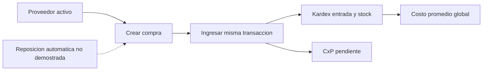

# Proceso abastecimiento

Objetivo: flujo empresarial focal. Evidencia: CompraServiceImpl.java:60-115,284-343. Prefijo de implementaciones: backend/src/main/java/com/policalum/erp/application/service/serviceImpl/. Sin validacion Mermaid renderer.

