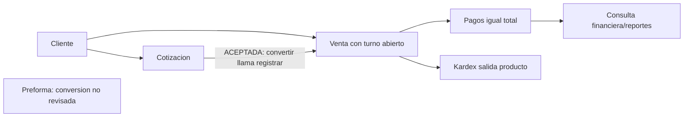

# Proceso comercial

Objetivo: flujo empresarial focal. Evidencia: VentaServiceImpl.java:45-91; CotizacionServiceImpl.java:261-282; conversion de preforma no revisada. Prefijo de implementaciones: backend/src/main/java/com/policalum/erp/application/service/serviceImpl/. Sin validacion Mermaid renderer.

