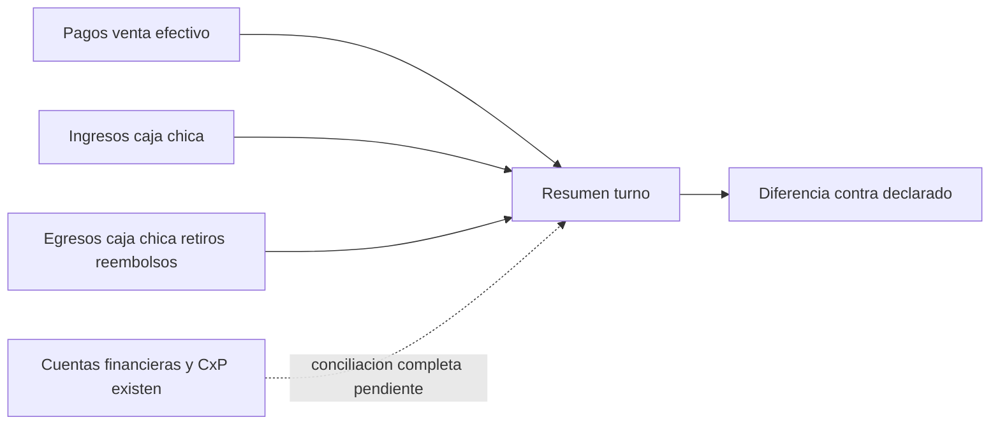

# Proceso financiero

Objetivo: flujo empresarial focal. Evidencia: TurnoCajaServiceImpl.java:86-102; mappings financieros. Prefijo de implementaciones: backend/src/main/java/com/policalum/erp/application/service/serviceImpl/. Sin validacion Mermaid renderer.

