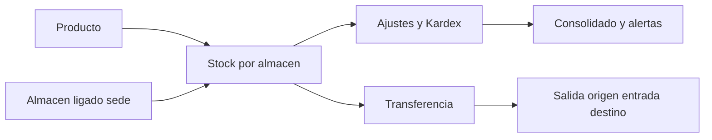

# Proceso inventario

Objetivo: flujo empresarial focal. Evidencia: Stock.java:39-45; StockOperacionServiceImpl.java:89-297. Prefijo de implementaciones: backend/src/main/java/com/policalum/erp/application/service/serviceImpl/. Sin validacion Mermaid renderer.

