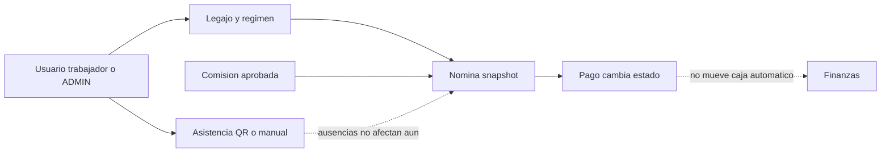

# Proceso rrhh

Objetivo: flujo empresarial focal. Evidencia: NominaServiceImpl.java:81-140,179-207,302-362; PoliticaRemuneracionServiceImpl.java:70-75. Prefijo de implementaciones: backend/src/main/java/com/policalum/erp/application/service/serviceImpl/. Sin validacion Mermaid renderer.

