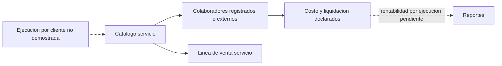

# Proceso servicios

Objetivo: flujo empresarial focal. Evidencia: ServicioServiceImpl.java:124-205; VentaServiceImpl.java:168-180. Prefijo de implementaciones: backend/src/main/java/com/policalum/erp/application/service/serviceImpl/. Sin validacion Mermaid renderer.

