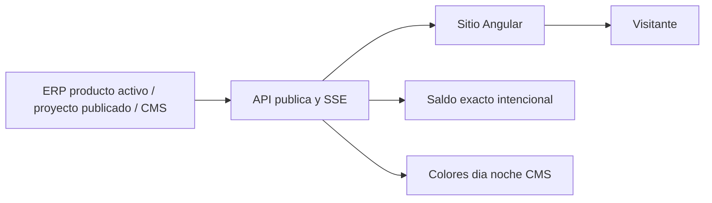

# Proceso web

Objetivo: flujo empresarial focal. Evidencia: PortalPublicoService.java:57-70,143-197; cms.store.ts:65-103. Prefijo de implementaciones: backend/src/main/java/com/policalum/erp/application/service/serviceImpl/. Sin validacion Mermaid renderer.

