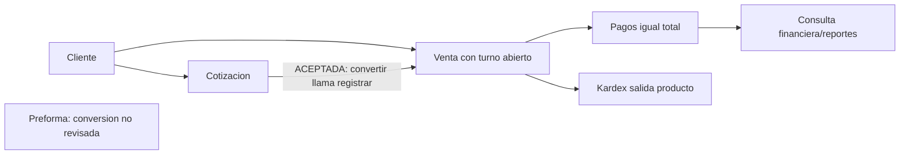
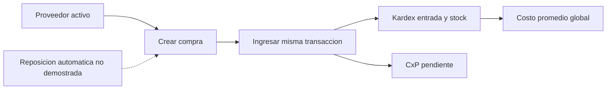
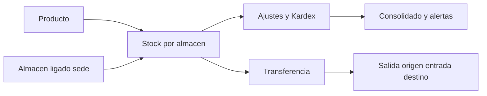
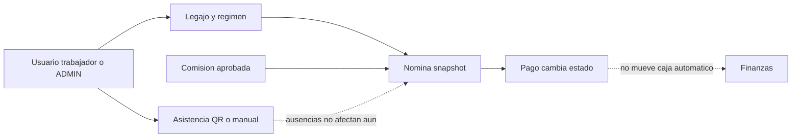
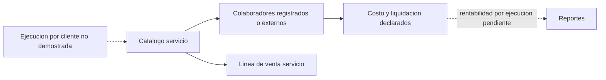
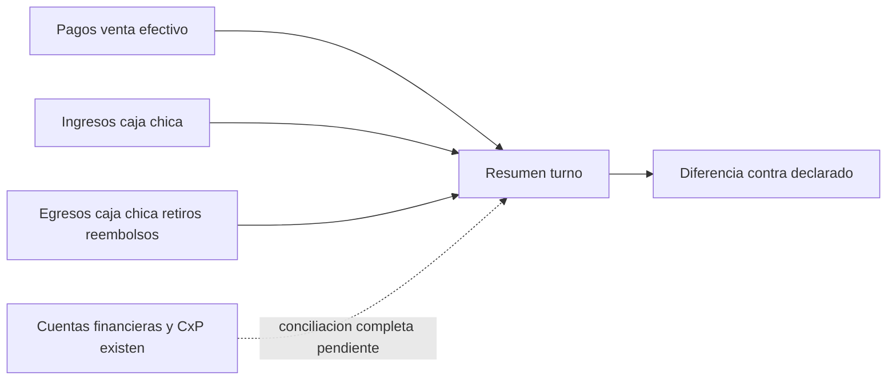
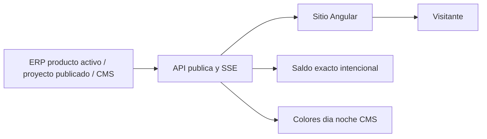

# 07. Procesos empresariales

Lineas continuas: enlace focal confirmado. Lineas discontinuas: limites/procesos no demostrados; NO propuestos como implementados. Recepcion de compra nueva automatica, servicio no equivale a orden de trabajo, pago nomina no mueve caja.

## Flujo general en imagen

[Ver PNG general](../FLUJO_GENERAL_POLICALUM.png). Cinco grupos con ramas independientes y etiquetas de llamadas, requisitos y consultas. Las cotizaciones aceptadas se convierten a venta en el servicio real; no se presume el mismo enlace para preformas.

## comercial

Objetivo: explicar dependencia empresarial comercial. Participantes: nodos del diagrama.

Explicacion: seguir conexiones continuas; discontinuas son limites. Evidencia: VentaServiceImpl.java:45-91; CotizacionServiceImpl.java:261-282; conversion de preforma no revisada en `backend/src/main/java/com/policalum/erp/application/service/serviceImpl/:1`. Fuente Mermaid separada: [archivo](../diagramas/proceso-comercial.md).

## abastecimiento

Objetivo: explicar dependencia empresarial abastecimiento. Participantes: nodos del diagrama.

Explicacion: seguir conexiones continuas; discontinuas son limites. Evidencia: CompraServiceImpl.java:60-115,284-343 en `backend/src/main/java/com/policalum/erp/application/service/serviceImpl/:1`. Fuente Mermaid separada: [archivo](../diagramas/proceso-abastecimiento.md).

## inventario

Objetivo: explicar dependencia empresarial inventario. Participantes: nodos del diagrama.

Explicacion: seguir conexiones continuas; discontinuas son limites. Evidencia: Stock.java:39-45; StockOperacionServiceImpl.java:89-297 en `backend/src/main/java/com/policalum/erp/application/service/serviceImpl/:1`. Fuente Mermaid separada: [archivo](../diagramas/proceso-inventario.md).

## rrhh

Objetivo: explicar dependencia empresarial rrhh. Participantes: nodos del diagrama.

Explicacion: seguir conexiones continuas; discontinuas son limites. Evidencia: NominaServiceImpl.java:81-140,179-207,302-362; PoliticaRemuneracionServiceImpl.java:70-75 en `backend/src/main/java/com/policalum/erp/application/service/serviceImpl/:1`. Fuente Mermaid separada: [archivo](../diagramas/proceso-rrhh.md).

## servicios

Objetivo: explicar dependencia empresarial servicios. Participantes: nodos del diagrama.

Explicacion: seguir conexiones continuas; discontinuas son limites. Evidencia: ServicioServiceImpl.java:124-205; VentaServiceImpl.java:168-180 en `backend/src/main/java/com/policalum/erp/application/service/serviceImpl/:1`. Fuente Mermaid separada: [archivo](../diagramas/proceso-servicios.md).

## financiero

Objetivo: explicar dependencia empresarial financiero. Participantes: nodos del diagrama.

Explicacion: seguir conexiones continuas; discontinuas son limites. Evidencia: TurnoCajaServiceImpl.java:86-102; mappings financieros en `backend/src/main/java/com/policalum/erp/application/service/serviceImpl/:1`. Fuente Mermaid separada: [archivo](../diagramas/proceso-financiero.md).

## web

Objetivo: explicar dependencia empresarial web. Participantes: nodos del diagrama.

Explicacion: seguir conexiones continuas; discontinuas son limites. Evidencia: PortalPublicoService.java:57-70,143-197; cms.store.ts:65-103 en `backend/src/main/java/com/policalum/erp/application/service/serviceImpl/:1`. Fuente Mermaid separada: [archivo](../diagramas/proceso-web.md).

